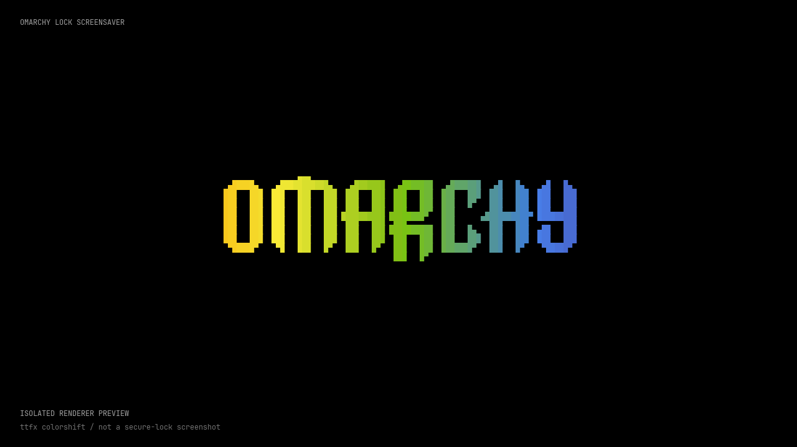

# Omarchy Lock Screensaver

The actual Omarchy `ttfx` effects, painted across the secure lock screen. This is a **lock-screen plugin**, not a standalone screensaver or a replacement authentication system.

**Beta · v0.1.1 · MIT · unofficial and not security-audited.** Review the code before installing: Omarchy plugins run as your user inside the shell.

[Source](https://github.com/ericdlaspe/omarchy-lock-screensaver) · [v0.1.1 release / downloads](https://github.com/ericdlaspe/omarchy-lock-screensaver/releases/tag/v0.1.1) · [Security](SECURITY.md) · [Changelog](CHANGELOG.md)

## What it does

- Displays the real `ttfx` animation with screen-sized effects on manual and automatic secure lock.
- Returns to the animation after 30 seconds without lock-screen input, clearing unfinished password and failure text. Activity is synchronized across outputs, and the countdown pauses during password authentication. Returning to the animation does not wake the display or restart its display-off timer.
- Keeps the installed Omarchy lock's session-lock and PAM/authentication behavior. There is **no authentication bypass**: dismissing the animation or waking the display does not unlock the session.
- Uses a Python terminal-frame bridge and native Qt painting, with a configurable **60 FPS target** by default. It is CPU work, not a promise of free rendering or a minimum frame rate.
- Configures locked-screen display blanking to **30 minutes** by default. Change it explicitly with `--blank-minutes`; this is separate from when the screensaver starts or the session locks.
- Leaves existing idle/screen-lock timings and fonts alone. It does not force a font installation.

## Install (recommended)

Run these commands in a terminal in your **local, unlocked Omarchy graphical session**. Do not install, update, uninstall, reload the shell, or edit plugin files while locked. Keep the session unlocked until the operation finishes, and do not switch lock plugins concurrently.

```bash
git clone https://github.com/ericdlaspe/omarchy-lock-screensaver.git
cd omarchy-lock-screensaver

# The only step that needs package-manager privilege elevation:
omarchy pkg add base-devel qt6-base qt6-declarative python-pyte pkgconf

./bin/install
./bin/status
```

This expects an existing Omarchy installation with its working `quickshell` and `ttfx`. Build tools include `qmake6`, `make`, and a C++ compiler; Python needs `pyte` (Arch package `python-pyte`). The installer builds the native renderer locally. **Do not run the installer with `sudo`.** There is no automatic network installation with `pip`.

The installer requires working Omarchy shell IPC and a positively verified unlocked compositor. It refuses SSH sessions and missing or ambiguous lock-state evidence rather than guessing. An existing custom lock is refused unless you explicitly choose `--replace-existing-lock`; inspect what you are replacing first.

To inspect the proposed operation:

```bash
./bin/install --dry-run
```

### Alternative: Omarchy plugin checkout

The plugin manager can clone the repository, but it does **not** build the renderer or install dependencies. Use clone-first, **without `--enable`**:

```bash
omarchy plugin add https://github.com/ericdlaspe/omarchy-lock-screensaver.git --yes
omarchy pkg add base-devel qt6-base qt6-declarative python-pyte pkgconf
~/.config/omarchy/plugins/ericdlaspe.lock-screensaver/bin/install
```

Here `--yes` accepts the repository-add confirmation and leaves the plugin disabled until its installer runs. Review the repository before doing this. If you omit `--yes`, decline the plugin manager's immediate-enable prompt. Do not use `omarchy plugin enable` instead of the installer: cloning/enabling alone is not a complete installation. The path above is Omarchy's standard plugin checkout location.

## Options

Set options by rerunning the installer while unlocked:

```bash
./bin/install --fps 60 --blank-minutes 30
```

| Option | Purpose |
| --- | --- |
| `--fps 60` | Requested animation frame rate; integer range 15–120. Not a delivered-FPS guarantee. |
| `--blank-minutes 30` | Locked-screen display-blanking interval, in minutes; separate from idle-to-lock timing. |
| `--metrics` | Opt in to animation performance diagnostics. Review and redact diagnostics before sharing. |
| `--python PATH` | Use an explicit Python interpreter that already has `pyte`. |
| `--replace-existing-lock` | Explicitly allow replacing another custom lock selection. |
| `--dry-run` | Inspect without applying installation changes. |

For an existing virtual environment, for example:

```bash
./bin/install --python "$HOME/.venvs/lock-screensaver/bin/python"
```

That environment must already provide `pyte`; the installer does not create it or fetch packages. Keep the selected interpreter and checkout available for the installed runtime.

The 30-minute default is a locked-screen blanking timer, not a delay before secure locking. Existing idle settings (including any 150-second screensaver / 300-second lock configuration) are preserved. Locked-screen input follows the installed stock lock's wake/reset behavior.

## Update safely

**Unlock locally first. Never pull, rebuild, switch versions, or reload this plugin while locked.** A shell reload during secure lock can strand the compositor in its orphaned-lock failsafe.

From the checkout used for installation:

```bash
git pull --ff-only
./bin/install --fps 60 --blank-minutes 30
./bin/status
```

Repeat any nondefault installer options you want to keep, including `--python` or `--metrics`. If installed with `omarchy plugin add`, use that plugin checkout as your working directory.

After an Omarchy update, rerun the installer while unlocked even if this repository has not changed. It generates a new local runtime from **your currently installed stock lock**, rather than shipping an old authentication implementation. It refuses unrecognized source shapes. Installed generated runtimes do not automatically rebase themselves onto upstream lock changes.

## How installation and recovery work

The plugin ID is `ericdlaspe.lock-screensaver`, cloning the role of `omarchy.lock`. Installation copies the installed stock lock into a versioned user runtime, applies guarded animation/display-timer edits, and builds the native renderer. Packaged files under `/usr/share/omarchy/` are not modified. User data/state paths respect `HOME` and XDG locations; there is no machine-specific username to edit.

Only the lock selection is changed in shell configuration. The installer records backups/restoration state, merges against fresh configuration, and restores temporary idle suppression in cleanup even when installation fails. Restoration is verified; IPC failure is reported rather than silently treated as success. If automatic idle cannot be restored, do not leave the machine unattended: resolve that warning locally. The loader chooses the generated runtime at startup and falls back to the stock lock if a runtime is absent or cannot load; this is not a promise to recover from every process/compositor failure.

Recovery backups live under `${XDG_STATE_HOME:-$HOME/.local/state}/omarchy-lock-screensaver/backups/`. The operation's result or activation-failure message identifies its backup directory. `recovery.json` records whether the prior configuration/runtime pointers existed and where an older managed source checkout was saved. Existing `shell.json`, `active.json`, and `uninstall.json` are backed up before pointer/configuration writes. Do not blindly copy a stale full `shell.json` over later edits. If lock state becomes pending, locked, or unknown, automatic rollback refuses to replace/reload the client; unlock locally and inspect the backup before recovery.

To restore the previous lock selection, **while unlocked**, from the same checkout:

```bash
./bin/uninstall --dry-run
./bin/uninstall
```

Uninstall merges back the previous lock selection while preserving later bar/idle edits. If lock selection has changed independently, it refuses to overwrite it blindly. The checkout, backups, and generated runtimes remain for diagnosis; uninstall is not a data wipe.

If the animation fails, wake/dismiss it and use the normal stock password interface. The animation bridge receives no keyboard/password input; its terminal input is not used for authentication. If the entire shell fails, treat that as a lock/compositor failure, not an animation-only failure. Do not kill or reload a live session-lock client to troubleshoot. Use your established local recovery procedure; never send anyone your password.

## Performance and verification limits

The default is a **60 FPS target**, not a guaranteed 60 FPS or even a global 30 FPS floor. Full-screen terminal effects cost CPU and scale with resolution, display count, scaling, effect, and hardware. A small, centered grid is cheaper but is not equivalent to screen-sized effects. `--fps` controls the target; lower it explicitly if you prefer less CPU use.

Development observations on one host used Omarchy **4.5.0-3**, Qt **6.12.0-3**, Quickshell **0.3.2**, and `ttfx` **0.5.0**. Full-screen rendering measured about **45 FPS** in three five-second samples; a limited central grid measured about **59 FPS**. These are hardware-specific observations, not benchmarks for every machine or effect. A slow preview is not a measurement of the real secure lock.

The display-off interval is configured to 30 minutes by default. Configuration inspection is **not** proof that a full 30-minute locked interval and wake cycle have been observed. The 30-second prompt return and cross-output activity synchronization have isolated Qt tests; this version has not received a new physical multi-monitor or real PAM/unlock test. Likewise, headless/offscreen tests cannot prove compositor session-lock security, real password/PAM interaction, multi-monitor behavior, or physical display blanking. Verify manual lock, automatic lock, password unlock, and wake behavior locally before relying on this beta.

## Tests and contributing

```bash
./bin/test
```

The test entry point covers Python unit tests, native build, offscreen renderer tests, and isolated Qt QML prompt-timer tests. The prompt tests run in CI without requiring Quickshell, including shared activity across two simulated outputs, repeated timeout cycles, disabled input, and authentication pause/resume. These are simulated output tests, not physical multi-monitor validation. It does not install the plugin or replace local secure-lock testing. CI is configured to run that entry point in an Arch Linux container; a workflow file is not a claim that a remote run has passed. See [CONTRIBUTING.md](CONTRIBUTING.md) for checks and safe testing rules.

For ordinary bugs, use the repository's issue forms and include redacted versions, display details, reproduction steps, and whether the issue occurs in preview or real lock. Do not post passwords, full private configuration, or unredacted desktop captures. For authentication, input disclosure, or lock-bypass concerns, follow [SECURITY.md](SECURITY.md), not a public bug report.

## License and attribution

New project code is MIT, copyright © 2026 Eric Laspe. Omarchy and its installed lock sources retain their upstream MIT notices and copyright holders. Production lock sources are generated locally from the installed package, not taken from the compatibility-test fixture. See [LICENSE](LICENSE) and [NOTICE](NOTICE) for the project license and upstream attribution.
